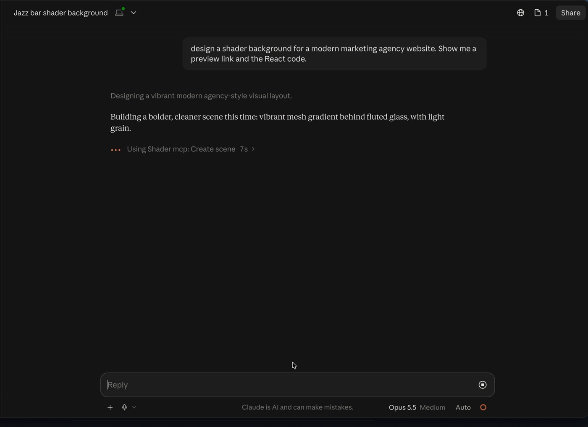
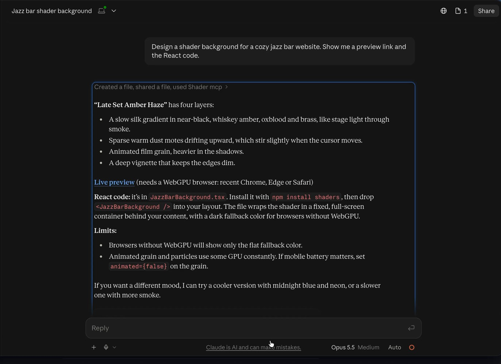
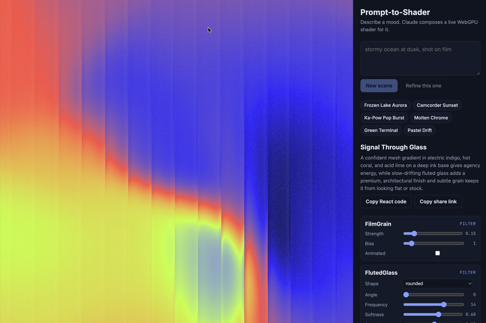

# shader-mcp

An [MCP](https://modelcontextprotocol.io) server that lets AI assistants like Claude design live, animated WebGPU shader scenes with the [`shaders`](https://shaders.com) library.

Ask Claude *"make me a moody synthwave background for my portfolio"* and it browses the effect catalog, composes a layered scene, has it validated, and hands you a **live preview link** and **ready-to-paste React code**.

It's the tool-use companion to [Prompt-to-Shader](https://github.com/diorgans/prompt-to-shader) ([live](https://prompt-to-shader.vercel.app/)): the same catalog and validator, exposed so any MCP-capable assistant can drive them.

## See it in action

Asked in Claude Desktop: *"Design a shader background for a modern marketing agency website. Show me a preview link and the React code."*

**1. Claude calls the tools.** It browses the catalog, reads the settings it needs, then validates its scene with `create_scene`:



**2. It explains the design and hands over a preview link and code** (here, for an earlier jazz-bar request):



**3. The preview link opens the scene live** in the [Prompt-to-Shader](https://prompt-to-shader.vercel.app/) app, ready to tweak:



## Tools

| Tool | What it does |
|---|---|
| `list_shaders` | Lists ~70 curated effects, as generators (paint pixels) or filters (transform what's beneath). |
| `describe_shader` | Every setting of the chosen effects: type, range, default, and what it does. |
| `create_scene` | Validates a layered scene. Clamps out-of-range values, reports real errors for the model to fix, and returns a live preview link. |
| `export_code` | Turns a valid scene into a self-contained React component. |

All tools are read-only and run locally. The server never calls an AI model or the network. The preview link renders entirely from the URL in your browser.

## Install

Requires Node 20+.

```bash
git clone https://github.com/diorgans/shader-mcp && cd shader-mcp
npm install && npm run build
```

**Claude Code**

```bash
claude mcp add --scope user shader-mcp -- node /absolute/path/to/shader-mcp/dist/index.js
```

**Claude Desktop**: add this to `claude_desktop_config.json` (Settings → Developer → Edit Config), then restart Claude:

```json
{
  "mcpServers": {
    "shader-mcp": {
      "command": "node",
      "args": ["/absolute/path/to/shader-mcp/dist/index.js"]
    }
  }
}
```

Set `SHADER_PREVIEW_URL` in the server's environment to point previews at your own deployment of Prompt-to-Shader.

## Design notes

- **Descriptions are the interface.** The model only knows what the tool descriptions and catalog tell it. The catalog carries each setting's meaning, not just its range, after an eval of Prompt-to-Shader showed the model reading `Pixelate.scale` backwards when it saw only `1..200`.
- **Errors are written for the model.** `create_scene` separates *fixes* (applied silently, then reported) from *errors* (returned with `isError` so the assistant corrects and resubmits), the same repair loop the web app runs server-side.
- **One source of truth.** The scene catalog and validator are generated from the `shaders` registry and shared with the web app (`src/scene/`), so the assistant can't use an effect or setting the renderer doesn't support.

## Development

```bash
npm test        # drives the server through a real MCP client
npm run build
npx @modelcontextprotocol/inspector node dist/index.js   # interactive tool explorer
```
